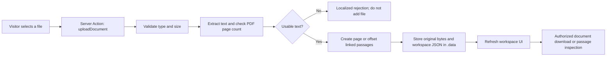
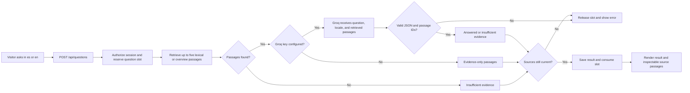

<!-- BEGIN:nextjs-agent-rules -->

## This is NOT the Next.js you know

This version has breaking changes — APIs, conventions, and file structure may all differ from your training data. Read the relevant guide in `node_modules/next/dist/docs/` (resolved from this file's directory; in monorepos the `next` package may not be visible from the repo root) before writing any code. Heed deprecation notices.

This block is written and re-added by `next dev` — verify at `node_modules/next/dist/server/lib/generate-agent-files.js`. Removing it from a diff only re-creates the uncommitted change; committing it with your work keeps the tree clean.

<!-- END:nextjs-agent-rules -->

# Document Intelligence agent guide

Read [PRODUCT.md](PRODUCT.md) for product intent and [README.md](README.md) for scope and references. This file records the implementation vocabulary, boundaries, and application flow. Update it when the design changes; do not present a proposed stage as working.

## Language

- Use English for code, identifiers, comments, configuration, and technical documentation.
- Use Spanish as the initial interface language and support English through the existing language switcher. Keep both translations together in `src/lib/i18n.ts`.
- Persist the user's locale in the locale cookie. Send `es` or `en` explicitly with every question; do not infer answer language from the question or browser.
- Write generated claims in the selected language. Keep any direct quotation from a document in the document's original language.
- Localize limits, empty states, errors, and insufficient-evidence results. Do not call a list of matching passages an AI answer.

## Glossary

| Term                  | Meaning in this application                                                                                                              |
| --------------------- | ---------------------------------------------------------------------------------------------------------------------------------------- |
| Workspace             | Temporary group of one visitor's documents and questions, addressed by a random session token. It is not an account.                     |
| Source document       | The original uploaded file. Its name, type, size, page count when available, and passages are recorded with it.                          |
| Passage               | A chunk of extracted document text with a stable ID, document ID, optional PDF page, and offsets in extracted text.                      |
| Retrieval             | Selection of passages relevant to a question. Specific questions use lexical matching; recognized single-document overview requests sample source passages. There are no embeddings or vector search. |
| Claim                 | One factual sentence in a model-generated answer, with one or more cited passage IDs.                                                    |
| Citation              | A reference from a claim to an existing passage. A valid ID proves the passage exists; it does not prove the passage supports the claim. |
| Insufficient evidence | A first-class answer outcome when retrieved material cannot support an answer.                                                           |
| Evidence-only mode    | Local, no-key behavior that shows retrieved passages without generating an AI answer.                                                    |
| Conversation history  | Saved questions and answers in the workspace. It is context for the interface, not evidence for a new claim.                             |
| Execution state       | Temporary progress of an upload or question request. Do not confuse it with conversation history.                                        |
| Question reservation | A short-lived server-side claim on one of ten question slots, used to bound concurrent provider calls. |
| Curated memory        | User-approved durable facts across sessions. This application does not have it and does not need it for the MVP.                         |

## Architecture and boundaries

The current application is an independent Next.js App Router and TypeScript project. The page is a Server Component that reads the locale and workspace. The interactive workspace is a Client Component. Server Actions handle user-initiated upload, deletion, and locale changes. Route Handlers handle question requests and authorized downloads. Parsing, retrieval, answer generation, and local persistence remain server-side.

| Area             | Current implementation                                                                                                           | Boundary or next decision                                                                                                                                                                                                                            |
| ---------------- | -------------------------------------------------------------------------------------------------------------------------------- | ---------------------------------------------------------------------------------------------------------------------------------------------------------------------------------------------------------------------------------------------------- |
| Browser | Bilingual upload, question, history, source passage, and delete UI. The Server Component sends only public workspace fields. | Never send the Groq key, pending reservation IDs, or another visitor's workspace data to the browser. |
| Session and data | Random HttpOnly session token; local `.data/workspaces/` files and JSON.                                                         | This is a local prototype. Choose a database for workspace metadata, passages, and questions, plus object storage for originals, before a public multi-instance deployment. PostgreSQL is the current recommendation, not an implemented dependency. |
| Intake           | Text extraction for PDF, DOCX, TXT, and MD; 10-page PDF and 10 MB file limits; passage IDs and offsets.                          | Scanned PDFs are rejected. OCR, durable ingestion jobs, and parser quality checks are later work.                                                                                                                                                    |
| Retrieval        | Bounded lexical ranking across the current workspace.                                                                            | Evaluate recall before choosing embeddings or hybrid search.                                                                                                                                                                                         |
| Answer           | Optional server-side Groq call with explicit locale and a Zod-validated JSON shape; cited IDs must belong to retrieved passages. | Structural citation checks are implemented. Semantic claim support, bilingual quality, and refusal behavior still need evaluation.                                                                                                                   |
| Retention | Successful uploads and saved questions renew access for 24 hours; reads and downloads do not. Expired workspaces are removed on access, and manual deletion is available. | Schedule background deletion of expired workspaces and all derived data before public release. |
| Abuse controls | Per-workspace file limits and atomic question reservations; stale reservations expire after two minutes. | Add global rate limiting and durable cross-instance quota coordination before public use. |

The original uploaded bytes and extracted passages are separate data. Questions and answers are conversation history. None of them is curated memory. Source passages are untrusted input, including when they contain instructions aimed at the model.

### Upload and source flow (current)

### Question and answer flow (current)

## Orchestration

Use an explicit, bounded pipeline for this application: **authorize → validate → parse or retrieve → generate when configured → validate → persist → render**. Each stage has one responsibility and an observable failure outcome. The question Route Handler coordinates the current answer path; it is not a multi-agent system. The upload Server Action coordinates intake. Keep provider calls behind the answer function so the model can be changed without changing source or session rules.

Do not ask the model to decide which workspace to read, whether a citation exists, whether a quota is reached, or whether a deterministic limit is valid. Code handles those decisions. Treat a model response with an unknown passage ID as invalid. Treat a real passage ID as a structural check only; evaluate whether it actually supports the claim separately.

Long-running parsing or OCR may later move to a durable job and worker, with explicit states such as `queued`, `processing`, `ready`, and `failed`. Introduce specialist agents only if an evaluation shows an improvement over the simple pipeline. The first evaluation set should include answerable and unanswerable questions, Spanish and English questions, multi-file questions, and citation support judged against the actual passage text.

## Implementation map

- `src/app/page.tsx`: server read of locale and workspace.
- `src/app/workspace.tsx`: localized interactive interface.
- `src/app/actions.ts`: upload, deletion, and locale Server Actions.
- `src/app/api/questions/route.ts`: question request coordinator.
- `src/app/api/documents/[id]/route.ts`: session-scoped original download.
- `src/lib/parse-document.ts`: extraction and passage creation.
- `src/lib/retrieval.ts`: lexical passage ranking and narrow single-document overview selection.
- `src/lib/answer.ts`: optional Groq call and structured answer validation.
- `src/lib/storage.ts`: local workspace files, session scope, and expiry on access.
- `src/lib/i18n.ts`, `src/lib/limits.ts`, `src/lib/types.ts`: copy, limits, and shared types.

## Working rules for the next change

1. State the user-visible behavior and whether it is implemented, prototype-only, or planned.
2. Keep all document access scoped to the session's workspace. Keep the Groq key on the server.
3. Preserve provenance when changing extraction, chunking, retrieval, or citations.
4. Explain uncertainty and insufficient evidence; do not manufacture claims or evaluation results.
5. Revisit this guide and the product README when architecture or scope changes.
